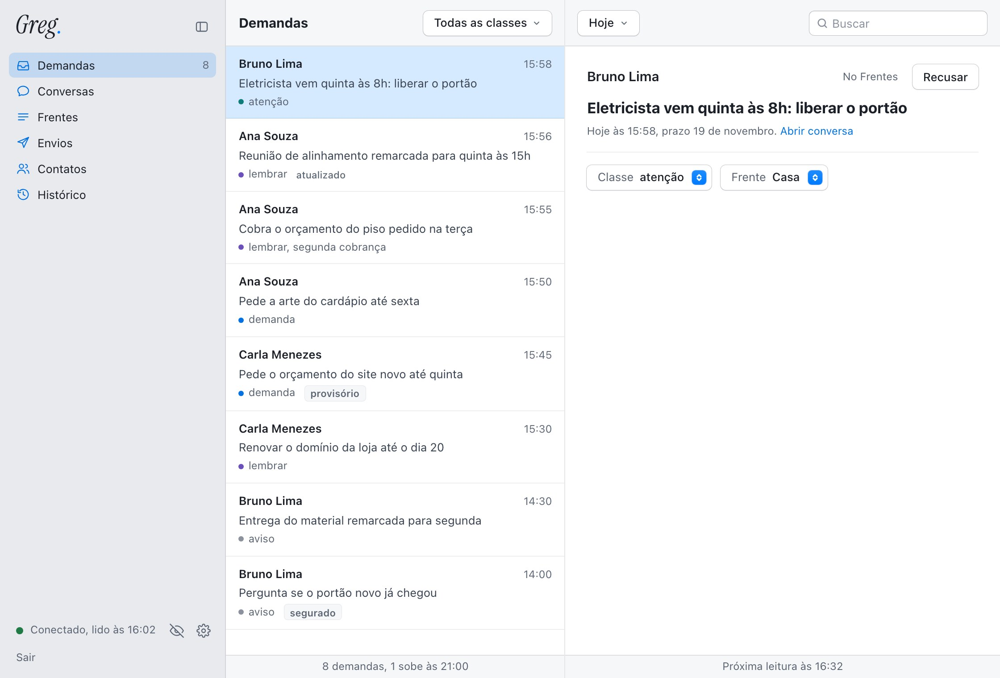
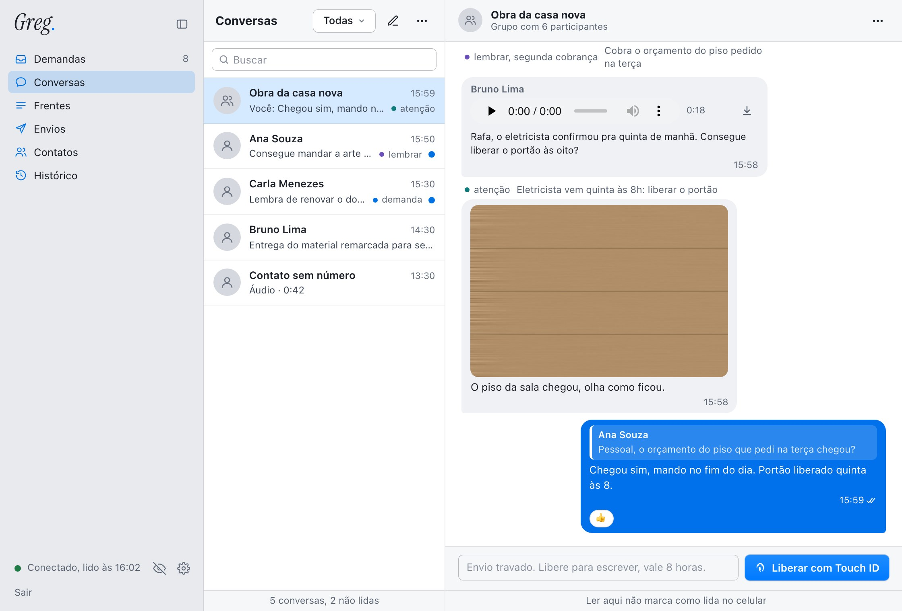
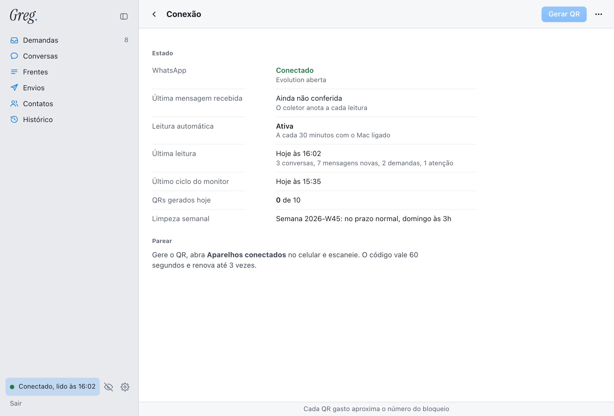
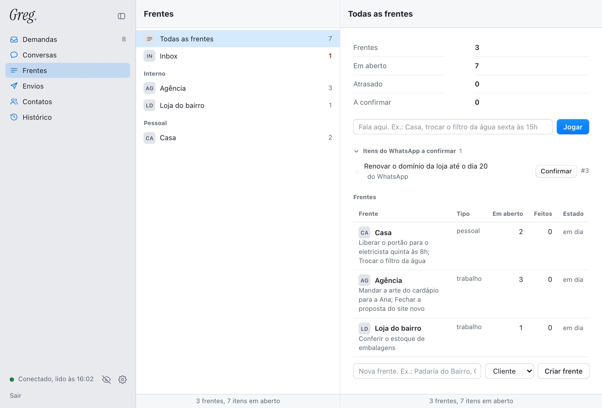
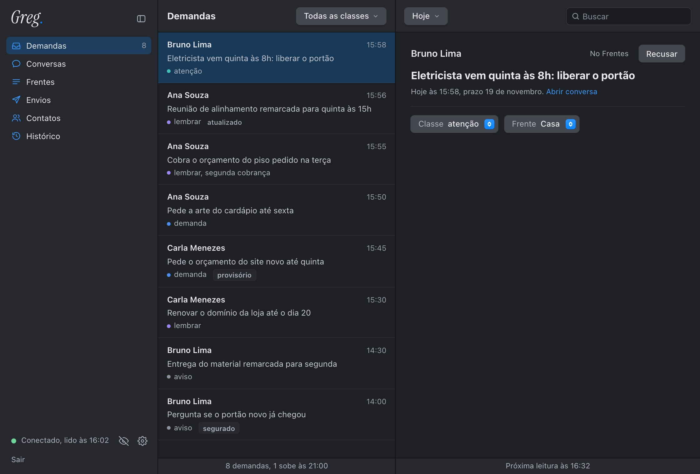
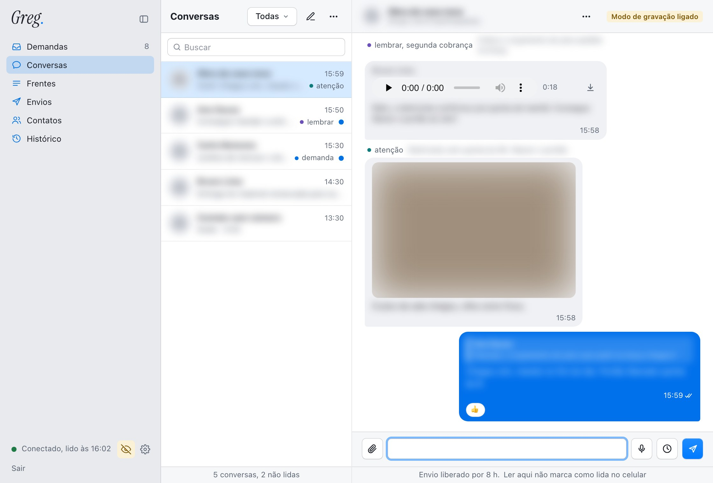
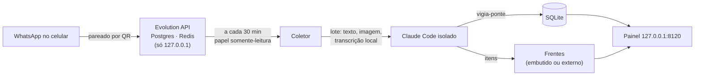

<p align="center"></p>
<h1 align="center">Greg</h1>
<p align="center">Leitura inteligente do seu WhatsApp, inteira na sua máquina.</p>
<p align="center"><sub>Python (só biblioteca padrão) · Evolution API local · Claude Code isolado · SQLite · Docker ou macOS nativo · MIT</sub></p>

O Greg lê o seu WhatsApp a cada 30 minutos (por padrão) **sem abrir as conversas**, entende o que está sendo pedido
(texto, imagem e áudio), transforma isso em itens organizados por frente (cliente, projeto, casa) e mostra tudo num
painel local. A sessão do WhatsApp, o banco, a classificação e o painel rodam no seu computador, em `127.0.0.1`.

> **Aviso.** O Greg usa a [Evolution API](https://github.com/EvolutionAPI/evolution-api), que conecta ao WhatsApp como
> um aparelho a mais (protocolo não oficial, via [Baileys](https://github.com/WhiskeySockets/Baileys)). Os Termos do
> WhatsApp não autorizam clientes não oficiais e o número pode ser restringido. Use com o **seu** número e por sua conta.
> O WhatsApp é marca da Meta; este projeto não tem relação com a Meta.

## Por que existe
Quem recebe dezenas de pedidos por dia no WhatsApp perde o que importa no meio do resto. O Greg resolve isso na sua
máquina, sem servidor do projeto recebendo nada: o que sai é a conversa com o WhatsApp e o lote que a sua IA lê. O cru
fica guardado pelo prazo que você escolhe e é apagado na limpeza semanal seguinte, e o celular continua sendo o único
lugar onde a mensagem é lida de verdade (o painel nunca marca como lida).

## O que ele faz
- **Lê sozinho.** A cada 30 minutos por padrão; você escolhe o intervalo (30 min, 1 h, 2 h ou 4 h) e o horário em
  Ajustes. Só o último dia antes do pareamento e o que chega depois.
- **Entende o pedido.** Um Claude Code isolado (`--restricted`, sem servidores MCP, só leitura do lote) classifica cada
  mensagem em demanda, atenção, lembrar, aviso ou sem ação, com resumo, prazo, confiança e a frente a que pertence.
- **Organiza por frente.** Itens confirmados viram pendências da frente certa; o que a IA não tem certeza fica numa caixa
  de entrada com Confirmar/Recusar, e cada decisão sua ensina o ciclo seguinte. Demandas repetidas na mesma conversa são
  fundidas no fechamento do dia (21:00).
- **Áudio vira texto.** Transcrição local e offline (Whisper: MLX no Mac, faster-whisper em CPU no Docker).
- **Mostra as conversas** com o que a IA entendeu ao lado de cada mensagem, sem marcar como lida.
- **Envia só quando você pede**, com trava interativa e tetos por dia; nunca disparo em massa.
- **Deixa de fora quem você quiser.** De grupo, a IA só lê o que você liberar em `[grupos] permitidos` do
  `config.toml`; os grupos aparecem em Conversas. Contatos e grupos bloqueados não são guardados, mostrados nem lidos
  pela IA.
- **Fecha a semana.** Relatório semanal, limpeza do cru com prova `count=0`, backup.
- **Vigia o próprio canal.** Detecta conexão "aberta" que parou de entregar, reinicia a Evolution e avisa.
- **Modo de gravação** (⌘⇧B): borra nomes, mensagens e números para você gravar a tela.

## Telas (dados fictícios)
| | |
|---|---|
| **Demandas** · caixa de entrada por classe, Confirmar/Recusar<br> | **Conversas** · fio, transcrição do áudio e o que a IA entendeu<br> |
| **Conexão** · estado do WhatsApp, leitura automática, QR sob demanda<br> | **Frentes** · itens por frente, o que veio do WhatsApp marcado<br> |
| **Demandas** · tema escuro<br> | **Conversas** · modo de gravação<br> |

As capturas saem de [`docs/imagens/gerar.py`](docs/imagens/gerar.py), com Evolution, Frentes e Postgres falsos e dados
inventados (números na faixa +1 415 555 01xx, reservada a ficção).

## Como funciona


## Instalar no Mac com o Greg.dmg (o mais fácil)
1. Baixe o `Greg.dmg` na página **Releases** deste repositório, abra e arraste o **Greg** para **Aplicativos**.
2. Abra o Greg. Na primeira vez o macOS avisa que não conseguiu verificar o app (ele ainda não é assinado com a conta
   paga de desenvolvedor da Apple) e só oferece fechar: clique em **Concluído**.
3. Vá em **Ajustes do Sistema → Privacidade e Segurança**, role até o aviso sobre o Greg e clique em **Abrir Mesmo Assim**;
   confirme com a senha do Mac. Isso é só na primeira vez.
4. A janela do Greg faz o resto e mostra cada passo: se não houver Docker, ele baixa e instala o Docker Desktop (aceite
   os termos na janela do Docker); pede o seu número; monta tudo (de 5 a 15 minutos na primeira vez, uns 3 GB); abre o
   Terminal só para você entrar na sua conta do Claude (`/login`, depois `/exit`); e termina na tela **Conexão**, onde
   você gera o QR e lê no celular.

Depois disso é só abrir o Greg: ele liga o Docker se precisar e entra no painel com o Touch ID. Os dados ficam em
`~/Library/Application Support/Vigia`. Para gerar o DMG a partir do código: `bin/construir-dmg.sh` (precisa das Command
Line Tools do Xcode).

## Instalar com Docker (Linux, Windows com WSL2, Mac)
Precisa de: Docker com Compose v2.20+, ~4 GB de RAM livre e uma assinatura do [Claude](https://claude.com) (é o Claude
Code que lê as mensagens).
```bash
git clone <url-deste-repositório> vigia && cd vigia
bin/preparar-docker.sh            # gera docker.env (0600) com senhas aleatórias
# abra docker.env e preencha DONO_WHATSAPP (seu número com DDI e DDD, só dígitos) e o TZ
docker compose up -d --build      # Evolution + Postgres + Redis + Greg
docker compose exec -it vigia claude   # uma vez: /login na sua conta do Claude, depois /exit
```
Abra **http://127.0.0.1:8120** e entre com o `VIGIA_TOKEN` do `docker.env`. Em **Conexão → Gerar QR**, leia o código no
celular (*Aparelhos conectados → Conectar um aparelho*). Pronto: a cada 30 minutos, ou no
intervalo que você escolher em Ajustes, o Greg lê o que chegou.

- Sem transcrição de áudio (imagem ~850 MB menor): `docker compose build --build-arg TRANSCRICAO=0`.
- Modelo de transcrição maior (mais preciso, mais lento em CPU): `--build-arg WHISPER_MODELO=medium`.
- Ajustes (janelas, tetos, horários, idioma): [`config.toml`](config.toml); depois `docker compose restart vigia`.
- Parar: `docker compose down` (os volumes ficam). Apagar tudo, inclusive a sessão do WhatsApp: `docker compose down -v`.

## Instalar no macOS sem Docker (nativo)
É o modo original: LaunchAgents, app nativo (WKWebView, Touch ID para liberar envio) e transcrição na GPU do Apple
Silicon. Precisa de Python 3.14 do Homebrew, [colima](https://github.com/abiosoft/colima) com Docker Compose (só para a
Evolution), Claude Code instalado e logado, e opcionalmente `mlx_whisper` e as Command Line Tools (`swiftc`).
```bash
cp .env.exemplo .env && cp infra/.env.compose.exemplo infra/.env.compose
chmod 600 .env infra/.env.compose       # preencher; senhas com: openssl rand -hex 24
bin/evolution.sh up                     # sobe a Evolution e aplica o SQL do Greg
bin/evolution.sh instancia              # cria a instância e grava a apikey no .env (sem imprimir)
bin/vigia.sh painel                     # painel em http://127.0.0.1:8120
bin/instalar-launchagent.sh --sim       # ciclo de 30 min, painel, fechamento da semana
bin/construir-app.sh                    # opcional: Greg.app em ~/Applications
```
Operação, pausa e desinstalação: [`docs/RUNBOOK.md`](docs/RUNBOOK.md).

## Frentes
"Frente" é tudo o que puxa um pedido: um cliente, um projeto, a casa. O Greg traz um **Frentes embutido** (SQLite em
`dados/frentes.db`), usado quando `FRENTES_URL` fica vazio. Se você já tem um sistema de tarefas, dá para apontar
`FRENTES_URL`/`FRENTES_TOKEN` para uma API com o mesmo contrato (`app/frentes_ponte.py`).

## Privacidade e segurança
1. **Tudo escuta em `127.0.0.1`.** Telemetria da Evolution desligada, transcrição offline. O que sai é o tráfego do
   WhatsApp (Evolution), a foto de perfil dos contatos (baixada do próprio WhatsApp) e o lote de cada leitura, que vai
   à Anthropic pelo Claude Code da sua conta ou ao provedor de IA que você escolher em Ajustes. A lista completa está
   em [`SECURITY.md`](SECURITY.md).
2. **Só leitura automática.** Envio exige pedido seu, liberação interativa (Touch ID no aplicativo do Mac; fora
   dele, o token de envio) e tetos por dia.
3. **Histórico curto.** A cada pareamento só o último dia para trás; o cru fica guardado pelo prazo que você
   escolhe (7 dias por padrão) e é apagado na limpeza semanal seguinte, com prova. Ficam os itens, os resumos e os
   arquivos guardados numa seção.
4. **Mensagem de terceiro é dado, nunca ordem.** O Claude roda isolado, com leitura só do lote e um único executável.
5. **Segredo nunca em argumento, log ou exceção.** Tokens em arquivos `0600`.

Como reportar um problema de segurança: [`SECURITY.md`](SECURITY.md).

**Quem usa é responsável pelo uso.** O Greg processa mensagens de outras pessoas. Para uso pessoal, a LGPD não se
aplica (art. 4º, I); usando para trabalho, você passa a ser o controlador desses dados.

## Desenvolvimento
```bash
python3 -m unittest discover -s testes -t .    # ~1.000 testes, sem rede, sem Evolution de verdade (sempre com -t .)
bin/ci.sh                                      # compila · segredos · compose · testes
git config core.hooksPath .githooks            # o pre-commit chama o ci.sh
```
Como propor mudança: [`CONTRIBUTING.md`](CONTRIBUTING.md).

## Licença
[MIT](LICENSE).
